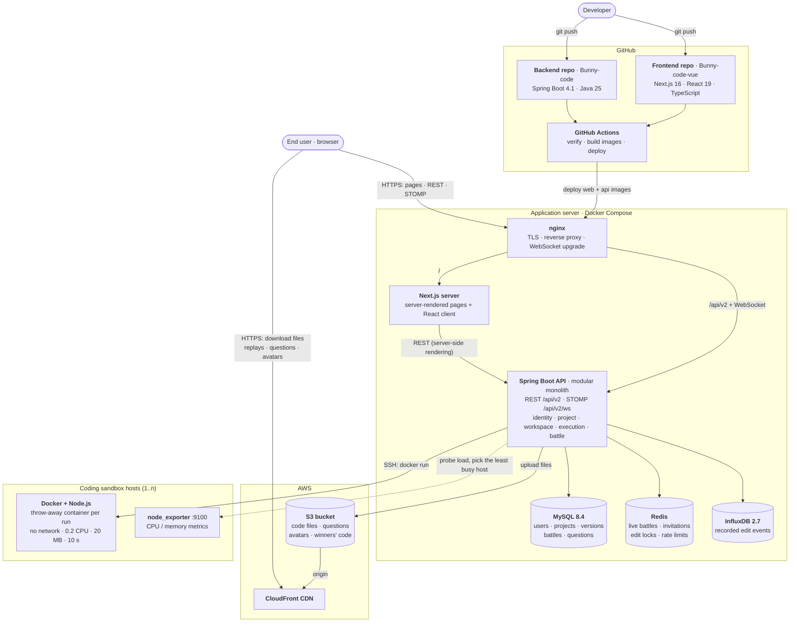

# Bunny Code

A coding site that records a session **keystroke by keystroke** and plays it back like
video — pause it, slow it down, scrub to the moment something clicked — plus live 1v1
coding battles.

Originally built in Vue 3 (2022). **Rewritten in React 19 / Next.js 16**, with the
original kept alongside in [`legacy/`](./legacy) so the two can be compared directly.

```bash
cd web && npm install && npm run dev   # http://localhost:3000
```

No backend, no database, no API keys. The app serves its own API — see
[Why there is no backend](#why-there-is-no-backend).

---

## Contents

- [What it does](#what-it-does)
- [Stack](#stack)
- [Why there is no backend](#why-there-is-no-backend)
- [Architecture](#architecture)
- [What the rewrite fixed](#what-the-rewrite-fixed)
- [Testing](#testing)
- [Running it](#running-it)
- [Trade-offs](#trade-offs)

---

## What it does

**Workspace** — open a project and watch it being written. Play, pause, 0.25x to 2x,
and drag the scrubber to any point. Run the file in the browser and see its output.
Projects have versions, and each version starts from the previous one's result, so
replaying a version shows you what changed and in what order.

**Battle Valley** — two people, one question, three attempts each. Both press ready, a
countdown runs, the question appears and both editors unlock. Code streams live between
them, submissions are judged against test cases, and the winner's solution is published
for everyone to read. Anyone can spectate, read-only.


---

## Stack

| | |
|---|---|
| **Framework** | Next.js 16 (App Router, RSC, Partial Prerendering) · React 19.3 |
| **Language** | TypeScript 5.9, `strict` + `noUncheckedIndexedAccess` |
| **Styling** | Tailwind CSS 4 (CSS-first `@theme` tokens) · Radix UI primitives |
| **Type** | JetBrains Mono as the display face, Archivo for interface prose |
| **Server state** | TanStack Query 5 |
| **Client state** | Zustand 5 |
| **Editor** | CodeMirror 6 |
| **Forms** | React Hook Form + Zod 4 (Zod also validates every API response) |
| **Testing** | Vitest 5 · Testing Library · fast-check · MSW 3 · Playwright · axe |
| **Tooling** | ESLint 10 (flat, with architectural boundary rules) · Prettier · Husky · GitHub Actions |

---

## Why there is no backend

The original backend is gone. `domingoos.store` returns `NXDOMAIN` and the CloudFront
bucket that held every file and question is dead:

```console
$ host domingoos.store
Host domingoos.store not found: 3(NXDOMAIN)
```

All 19 REST endpoints and 31 socket events pointed at it, so the Vue app can no longer
render a single screen. The API has since been rebuilt as **Bunny Code API v2** (Spring
Boot, the `Bunny-code` repository) and the app speaks only v2 — REST under `/api/v2` and
STOMP over WebSocket. So that the demo still deploys as a static site, the app also
**ships its own backend**, used whenever no API is configured:

- **HTTP** — [MSW](https://mswjs.io) handlers over a seeded in-memory domain model. The
  same handlers serve `next dev`, Vitest, Playwright, and the deployed demo (where the
  service worker genuinely *is* the API).
- **Realtime** — a `RealtimeTransport` interface with two implementations: STOMP against
  the API when `NEXT_PUBLIC_API_URL` is set, and an in-browser **scripted opponent** when
  it is not. The opponent readies up, types a real solution keystroke by keystroke,
  submits, and wins if you don't get there first. Both emit the same v2 snapshots and
  events, so the battle UI cannot tell which one it is talking to.
- **Code execution** — the original ran user code in a Docker container with a memory
  cap. That becomes a **Web Worker** with console capture and a hard timeout; the page
  terminates the worker, which is the only way to stop a synchronous `while (true) {}`.
  With the API configured, code runs in its Docker sandbox again (`POST /executions`).

The upside: the whole thing deploys as a static site and every feature works. The seeded
recordings are not hand-written fixtures either — they are generated by **driving the
real recorder**, so every one is provably replayable, and a test asserts exactly that.

---

## Architecture

```
web/src/
  core/          Pure TypeScript. No React, no Next, no I/O.
    replay/      applyEdit · recordEdit · timeline · ReplayClock
    sandbox/     code evaluation · console formatting · test-case judging
    realtime/    v2 realtime protocol · transport interface · handler registry
  features/      Vertical slices: auth · projects · user · workspace · battle
    <slice>/     api/ · components/ · hooks/ · model/ + index.ts (public barrel)
  components/ui/ Design-system primitives on Radix
  lib/           fetch client · schemas · validation · STOMP transport · sandbox worker
  mocks/         The demo backend: seeded db · MSW handlers (API v2) · scripted opponent
```

Two rules, **enforced by ESLint** rather than documented and hoped for:

1. `src/core/**` may not import React, Next, Zustand, TanStack Query, or any feature.
   That is what keeps the domain logic testable in isolation — and the `core` test
   project runs in Node with no DOM, so an accidental `document` reference fails the run.
2. Features import each other only through a public barrel (`@/features/battle`), never
   a deep path. Server-only code lives behind a separate `@/features/<name>/server`
   entry, so `next/cache` can never be pulled into the browser bundle.

### The heart of it

`core/replay/applyEdit.ts` is one pure, total function:

```ts
applyEdit(doc: DocState, record: EditRecord): DocState
```

**Both recording and replay go through it.** That is the whole design. In the original
these were two independently written implementations of the same thirteen
transformations, which is how they drifted apart — see below.

---

## What the rewrite fixed

These are specific, verified defects in `legacy/`, not stylistic preferences. Each one
now has a test that fails if it comes back.

**Replay did not reproduce what was recorded.** Backspace at column 0 was recorded as
`code: "\n"` ([`CodeMirrorComponent.vue:175`](./legacy/src/components/CodeMirrorComponent.vue))
but replay only joined lines when it saw `"\r\n"` (`:758`), so replaying a line-join
silently deleted a character instead. One reducer makes this unexpressible — the join is
decided from the cursor position, not from the payload. A fast-check property test
asserts the invariant over random keystroke sequences, and I mutation-tested it:
reintroducing the original bug fails 8 tests, including all four property tests.

**Replay ignored the recorded timing entirely.** Timestamps are nanosecond epoch strings
(`Date.now() + "000000"`), and the player parsed them with `new Date(nanosecondString)`,
which is `NaN`. `setTimeout(fn, NaN)` fires immediately, so every replay ran flat out
rather than at the speed it was typed.

**The replay scheduler leaked.** Teardown set `keepPlay = false` on the *ref object*
instead of `keepPlay.value` (`:1224`), so the flag never changed and pending timers kept
firing against an unmounted editor. Replaced by a clock whose disposal is tied to effect
cleanup.

**Replay could only go forwards.** Position was a `for` loop counter, so there was
nowhere to seek *to*. Position is now elapsed time and the document is a pure function of
it, so scrubbing backwards costs what scrubbing forwards does.

**Socket listeners leaked.** `socketOff(name)` called `removeAllListeners(name)`, so one
component unsubscribing tore down every other component's listener for that event.
`BattleView.vue` registered 11 handlers and removed 10 — `battleFinished` accumulated on
every visit. Subscriptions now return a disposer tied to the effect.

**Every failure path could throw while reporting.** `error.response.data.msg` was read
unconditionally, so any failure that wasn't a JSON API response — a dropped connection, a
proxy's HTML error page — threw a second error *while handling the first*, and the user
saw nothing.

**Nothing was keyboard accessible.** Project and user names were `<div>`s with `@click`
and `cursor: pointer`; focus outlines were removed (`outline: none`) without replacement.
The whole app is now keyboard-navigable with one visible focus style, and **axe runs
against every route in CI** at WCAG 2.1 AA.

**It was unusable on a phone.** A fixed `100vw` header with a 1.5rem font and 80px of
padding overflowed below ~700px, putting a horizontal scrollbar on every page. The battle
review page positioned a 700px editor at `right: 5%` and the profile at `left: -27vw`,
which overlapped below ~1200px. The suite now runs at phone width as well as desktop.

Also: 30 scattered `axios` call sites behind one validated client; a hardcoded host in 10
files behind one env module; `userID` and the socket prop-drilled through every screen
replaced by stores; `<div v-else></div>` replaced by real loading, empty and error
states; and `CLIENT_CATEGORY` / battle-level maps that were redeclared in four views
(two in English, two in Chinese) declared once.

---

## Testing

```
679 unit and integration tests   33 files
156 end-to-end tests             desktop + mobile viewports, demo mode
 21 integration tests            against the real API (two-browser battles included)

coverage (logic layers)   93.5% lines   91.7% statements   92.6% functions
  of which src/core       99.8% lines   100%  functions
```

Coverage is scoped to the layers unit tests are the right tool for — the pure
domain logic, the fetch/schema boundary, hooks, state machines and the mock
backend. React components are covered by the Playwright suite instead, which
drives a real browser on two viewports and runs axe on every route; asserting
the same behaviour again against jsdom would duplicate it at lower fidelity.

| Layer | What it covers |
|---|---|
| **Pure core** (Vitest, Node) | `applyEdit` per action; **record → replay round-trip property test** over random keystroke sequences; `ReplayClock` play/pause/seek/speed under an injected clock; sandbox timeout, console capture, output truncation; test-case judging |
| **Fixtures** | Every seeded recording replays to the file the API serves. Every battle solution is **executed in the sandbox** and judged by the same code the battle screen uses, so a wrong expected value fails the build |
| **Boundary** (Vitest + MSW) | Every v2 endpoint through the real client and the real Zod schemas — problem details, auth, privacy rules, error mapping; the STOMP transport against a fake broker client |
| **State machines** | The battle flow as a pure reducer over the server's snapshot and events: ready handshake, countdown, reconnect resync, duplicate `STARTED`, simultaneous endings, forfeits |
| **End-to-end** (Playwright) | Sign in → create project → type → **save → scrub to start → scrub to end → byte-identical file**; win a battle against the scripted opponent; infinite loop terminates instead of hanging the tab; paste is refused |
| **Accessibility** | axe on every route, zero violations, desktop and mobile |
| **Bundle** | Asserts the editor is not in the home page's JavaScript |
| **Integration** (Playwright, real API) | `npm run test:integration` against the Spring Boot API and its MySQL, Redis, InfluxDB, S3 and Docker sandbox: accounts, private projects, record → reload → replay, versions, stars, views, server-side runs, and two-browser battles (invitations, judged submissions, forfeit, spectators, expiry) |
| **The hero** | Asserts the home page's recording actually advances, exposes the finished code to assistive technology rather than the animation, and does not animate under `prefers-reduced-motion` |

The round-trip property test is the one that matters:

```ts
// Any random keystroke sequence must replay to a byte-identical document.
fc.assert(fc.property(startingText, fc.array(keystroke), (text, strokes) => {
  const { records, doc: recorded } = recordSession(docFromText(text), strokes);
  expect(docToText(applyEdits(docFromText(text), records)))
    .toBe(docToText(recorded));
}));
```

---

## Running it

```bash
cd web
npm install

npm run dev          # http://localhost:3000
npm run verify       # typecheck · lint · format · unit tests
npm run test:e2e     # Playwright, against a production build
npm run test:cov     # coverage, with per-directory thresholds
```

Sign in with the pre-filled demo account (`domingoos@gmail.com` / `test1234`), or
`guest@gmail.com` with the same password.

**To run against the real backend**, start the local stack and the API, then:

```bash
NEXT_PUBLIC_API_URL=http://localhost:8080/api/v2 npm run dev   # replaces MSW and the scripted opponent
npm run test:integration                                       # Playwright against the real API
```

The STOMP URL is derived from it (`…/api/v2/ws`); `NEXT_PUBLIC_REALTIME_URL` overrides it.
**[`INSTRUCTION.md`](../Bunny-code/INSTRUCTION.md)** in the backend repository covers the
whole local setup — MySQL, Redis, InfluxDB, S3, the API, demo data, and every test suite.

**Deployment:** `web/Dockerfile` builds the standalone Next.js server. `web-ci.yml` and
`web-release.yml` test it, publish it to GHCR and roll it out behind nginx next to the API,
with automatic rollback. See [`docs/CICD.md`](../Bunny-code/docs/CICD.md) in the backend repository.

---

## Trade-offs

Things I decided deliberately, and would defend in a review:

**The editor is fully controlled by the recorder.** CodeMirror is not allowed to change
its own document — a transaction filter rejects any edit that did not come from the
recorder. That is what makes a recording provably match the file, and it costs IME
composition, paste and multiple cursors. The original blocked paste outright and swallowed
every modifier combination, so nothing is lost, but it is a real constraint and the help
dialog says so.

**The auth token is in memory with a `sessionStorage` mirror.** With a real backend it
belongs in an httpOnly `SameSite=Lax` cookie, but there is no server to set one. This is
weaker than a cookie and stronger than the original's `localStorage` JWT: it is scoped to
the tab and gone when the tab closes.

**Server Components don't fetch application data.** A service worker doesn't exist on the
server, so RSC can't call the MSW API. The read-only seed slice is therefore read
directly on the server (`features/projects/server.ts`) with `use cache`, and everything
stateful is fetched client-side — one seed module, two access paths, no duplicated
behaviour.

**TypeScript is pinned to 5.9, not 7.** TS 7 is `latest` on npm and compiles this project
cleanly, but `typescript-eslint` refuses it outright (`typescript-eslint does not support
TS 7.0`). Working lint rules are worth more than a newer compiler.

**MSW is a production dependency.** It has to be: the deployed demo imports it at
runtime. It is most of why the first load is larger than it would otherwise be — a real
backend would remove it from the bundle entirely by setting `NEXT_PUBLIC_API_URL`.

**Two endpoints take JSON where the original took `multipart/form-data`.** Multipart only
existed because the backend forwarded the part to S3. There is no object store here and
the payload is a text file, so JSON is simply the right transport.

**The home page's hero is a live replay, not a screenshot.** What this product does cannot
be shown in a still image, because the whole point is what happens over time — so the
page plays a real seeded recording through the same `ReplayClock` the workspace uses. It
is also the only non-user-triggered motion in the app, and it stops entirely under
`prefers-reduced-motion`.

---

## Links

- **Frontend (this repo)**: [Bunny-code-vue](https://github.com/domingo1021/Bunny-code-vue)
- **Backend**: [Bunny-code](https://github.com/domingo1021/Bunny-code) — Bunny Code API v2:
  Spring Boot, MySQL, Redis, InfluxDB, S3, STOMP, Docker sandbox

The system this app is part of:


